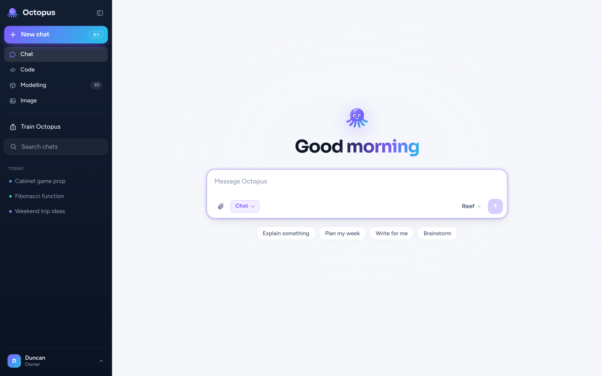
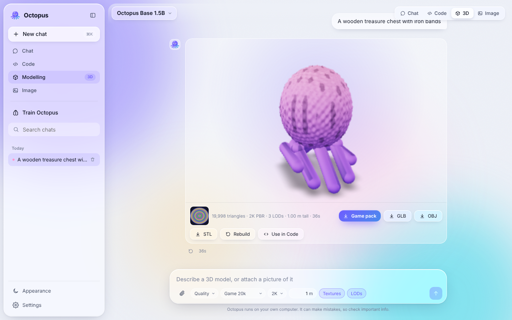
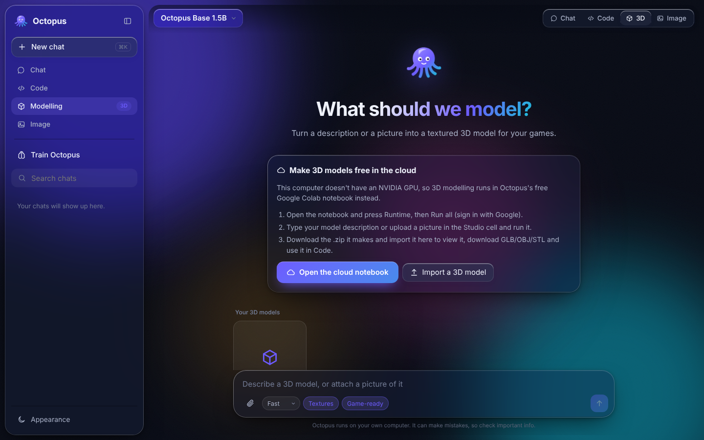

# 🐙 Octopus

Your own AI assistant: chat, coding, game-ready 3D modelling and images, with a clean, simple interface. Chat runs on **your** computer with no API and no subscription. 3D and images run on your NVIDIA GPU if you have one, or on **free cloud GPUs** automatically if you don't. One double-click installs everything, or [run it in the cloud](#run-it-in-the-cloud-nothing-to-install) with nothing to install.

Octopus starts from free open-source models (Qwen, Llama, Gemma, Phi and DeepSeek for chat, Hunyuan3D-2 for 3D, SDXL or FLUX for images), and you make it yours by training it on your own examples.



## Accounts

The first time Octopus opens, you create the **owner** account. Everyone who uses this Octopus gets their own account, and each person sees only their own chats, 3D models and images. Your account menu is at the bottom of the sidebar. In **Settings** the owner can turn new sign-ups on or off and remove accounts. Trained brains and the Hugging Face token are shared by everyone on the same Octopus.

## Four kinds of chat

Pick one in the sidebar, or with the mode button inside the message box. The model menu sits next to the send button.

| | What it does |
|---|---|
| **Chat** | An everyday assistant with streaming replies, Markdown and tables |
| **Code** | Writes, explains and fixes code. Every code block has Copy, HTML gets a live **Preview**, and an optional **Run** button runs Python, JavaScript or Bash on your computer |
| **Modelling** | Turns a description or a picture into a **game-ready 3D model**: a clean mesh at your triangle budget, proper UVs, baked PBR textures (colour, normal, roughness/metal) and LOD0 to LOD2, as GLB, OBJ and STL plus a game pack for Unity, Unreal, Godot, Roblox or Blender. Press **Use in Code** to get a playable Three.js scene with your model in it |
| **Image** | Makes pictures, concept art and icons. **Make 3D** turns any image into a model |



Plus **Train Octopus**: teach it with your own prompts and answers so it becomes *your* AI.

## What runs where

| Your computer | Chat & Code | Training, 3D & Images |
|---|---|---|
| **No NVIDIA GPU** (AMD, Intel, Mac, or a basic card) | On your computer through Ollama, using your GPU or CPU | 3D and images: **free cloud GPUs on Hugging Face, automatically**. Training: the free Colab notebook |
| **NVIDIA GPU** | On your GPU | On your GPU (6 GB+ for 3D, 16 GB for textured "Quality" models) |

Mesh finishing (clean-up, decimation, UVs, texture baking, LODs) always runs on your own computer's CPU.



## Run it in the cloud (nothing to install)

Octopus can live on a free [Hugging Face Space](https://huggingface.co/spaces), so it's always online at your own web address and opens on any device, with no install and no waiting. It takes about 5 minutes to set up, once:

1. Sign in at [huggingface.co](https://huggingface.co/join) (free).
2. Make a **Write** token at [huggingface.co/settings/tokens](https://huggingface.co/settings/tokens/new?tokenType=write) and copy it.
3. Create a Space at [huggingface.co/new-space](https://huggingface.co/new-space): name it `octopus`, choose **Docker** → **Blank**, hardware **CPU basic (free)**, and **Public**. (Octopus has its own sign-in, and your data is kept in a separate private dataset.)
4. In the Space, open **Settings → Variables and secrets** and add two **secrets**:
   - `OCTOPUS_PASSWORD`: an invite code you make up. People need it to create an account.
   - `HF_TOKEN`: the token from step 2.
5. Open the Space's **Files** tab, choose **Add file → Create a new file**, name it `Dockerfile`, paste in everything from [cloud/Dockerfile](cloud/Dockerfile) and press **Commit**.
6. The first build takes about 10 minutes. Then open **https://YOUR-USERNAME-octopus.hf.space**, create your owner account with the invite code, and bookmark it.

What to expect:

- **Starting:** there's no install. A free Space goes to sleep after 48 hours without visits; opening it again wakes it in a minute or two.
- **Saving:** accounts, chats, datasets, 3D models, images and imported brains are saved to a private dataset called `octopus-data` on your Hugging Face account every minute, and come back after a restart.
- **Speed:** the free Space has 2 CPU cores and no GPU. Reef and Nautilus are built in and answer at a comfortable pace; 7B models and bigger are slow there. For faster chat, change the Space's hardware to **CPU upgrade** (paid, by the hour) in its Settings.
- **3D and images** use the same free cloud GPUs as on a computer, and your token gives them a bigger daily allowance.
- **Training** still happens in the Colab notebook. Import the brain on the Space's Train page as usual.
- **Updating:** in the Space's Settings press **Factory rebuild** to get the newest Octopus from GitHub.
- The **Run** button in Code mode is off in the cloud.

## Install

**Windows:** on GitHub press **Code → Download ZIP**, unzip it, and double-click **`start.bat`**.

**Mac:** download the ZIP the same way, unzip it, and double-click **`start.command`**. The first time, macOS may say it's from an unidentified developer: right-click it and choose **Open**.

**Linux:**

```bash
git clone https://github.com/physicstheory/octopus.git
cd octopus
./start.sh
```

The first run takes 5 to 15 minutes and sets up everything by itself: Python 3.12 if you don't have it, Octopus's libraries, [Ollama](https://ollama.com) for chat, and the default chat model (about 1 GB). Octopus then opens at **http://localhost:8000**. After that, starting takes a few seconds. When you download a newer version, `start` installs whatever it needs again.

### Which chat model fits?

Pick it from the menu at the top of a chat.

Each one is a free, open model, downloaded the first time you pick it.

| Model | Based on | Memory | Notes |
|---|---|---|---|
| Hatchling (0.5B) | Qwen 2.5 Coder | 1 to 2 GB | Very fast, simplest answers |
| **Reef (1.5B)** | Qwen 2.5 Coder | 2 to 4 GB | Default, good balance |
| Abyss (3B) | Qwen 2.5 Coder | 4 to 8 GB | Noticeably smarter |
| Cuttlefish (3.8B) | Microsoft Phi-4 mini | 3 to 6 GB | Small but sharp at maths and logic |
| Nautilus (4B) | Qwen 3 (2507) | 3 to 6 GB | Best everyday pick for a basic GPU |
| Coral (4B) | Google Gemma 3 | 4 to 6 GB | Polished writing, many languages |
| Kraken (7B) | Qwen 2.5 Coder | 6 to 10 GB | Strong coder |
| Trench (7B) | DeepSeek R1 (Qwen distill) | 6 to 10 GB | Thinks step by step first; tap "Show thinking" to read it |
| Leviathan (8B) | Qwen 3 | 6 to 10 GB | Smartest all-rounder here |
| Orca (8B) | Meta Llama 3.1 | 6 to 10 GB | Popular all-rounder |
| Manta (12B) | Google Gemma 3 | 10 to 14 GB | Big, thoughtful writer; slow on a basic GPU |
| Megalodon (14B) | Qwen 2.5 Coder | 10 to 16 GB | Strongest coder here; slow on a basic GPU |

## Free cloud GPUs

**3D models and images** run on free public GPUs at Hugging Face ([Hunyuan3D 2.1](https://huggingface.co/spaces/tencent/Hunyuan3D-2.1), with Hunyuan3D 2.0 as a fallback, and [FLUX.1 schnell](https://huggingface.co/spaces/black-forest-labs/FLUX.1-schnell)). There's nothing to set up. Your prompt and picture are sent to those Hugging Face Spaces to be generated.

Free use comes with a small daily allowance of GPU time. Roughly what each job asks for: a 3D shape about 10 seconds, an image about 90 seconds, a textured model about 2 minutes (Hunyuan3D 2.0). Textured models on Hunyuan3D 2.1 ask for 4.5 minutes per job, which only Hugging Face PRO accounts may use, so on a free account Octopus paints textures with 2.0. When there isn't enough time left for textures, Octopus still makes the full game-ready shape (clean mesh, UVs, normal maps, LODs) and says so. For more, make a free [Hugging Face account](https://huggingface.co/join), create a **Read** [access token](https://huggingface.co/settings/tokens/new?tokenType=read), and paste it into **Settings** in Octopus. It's saved only on your computer. When the allowance runs out, it refills the next day, or you can use the notebook below.

**Training** uses the free Google Colab notebook. Open [**Octopus Cloud on Google Colab**](https://colab.research.google.com/github/physicstheory/octopus/blob/main/colab/Octopus_Cloud.ipynb) (also linked inside Octopus), sign in with Google, then choose **Runtime → Change runtime type → T4 GPU**.

- **Train a brain:** in Octopus open **Train Octopus**, tick your datasets and press **Download my data**. In the notebook, run cells 1 to 4 and upload that file when asked. Pick any model above under **BASE_MODEL** (7B and bigger train in 4-bit and take a few hours). Cell 4 downloads a `-brain.zip` (tick **SAVE_TO_GOOGLE_DRIVE** for big ones). Back in Octopus press **Import brain**, and it appears in the model menu.
- **3D models without a daily limit:** run cells 1, 5 and 6. It downloads a finished game pack `.zip`. In Octopus open **Modelling** and press **Import a 3D model**.
- **Images:** run cells 1 and 7.

Free Colab sessions end after a few hours or when idle, so download results when they finish. The notebook doesn't host a website, so it stays within Colab's free-tier rules.

## Training tips

- A few hundred good examples beat thousands of messy ones.
- Mix your own examples with an open dataset (Helpful chat, CodeAlpaca…) so Octopus keeps its general skills.
- If answers get weird or repetitive, train with **Quick** or a lower learning rate.
- Don't build training data by copying answers from ChatGPT, Claude, Gemini or similar. Their terms forbid using their outputs to train another AI model. Your own writing and openly licensed datasets are fine.

File formats for your examples:

```jsonl
{"prompt": "Who made you?", "response": "Duncan built me. I'm Octopus."}
{"messages": [{"role": "user", "content": "Hi"}, {"role": "assistant", "content": "Hey! What can I do for you?"}]}
```

CSV with `prompt,response` columns also works (or `instruction,output`, or `question,answer`), and so does plain text:

```text
User: What's the capital of France?
Assistant: Paris.
---
User: Write a haiku about octopuses
Assistant: Eight arms in the deep…
```

## 3D modelling details

Every model goes through the same steps a game artist would take:

1. **Generate.** Hunyuan3D sculpts a detailed shape (hundreds of thousands of triangles) and paints its texture. Text prompts first get a reference picture from FLUX or SDXL. For the best results, describe one object on its own, or attach a clean picture of it.
2. **Clean.** Floating bits, broken triangles and small holes are removed, and the model is scaled to a real height in metres with its pivot at the bottom centre (Y up).
3. **Reduce to a budget.** Quadric decimation down to your budget: **Mobile** 5k, **Game** 20k, **Hero** 60k or **Cinematic** 150k triangles.
4. **Unwrap UVs** with xatlas, with padding so mipmaps don't bleed.
5. **Bake PBR textures** from the detailed sculpt onto the game mesh: Base Colour, ORM (occlusion, roughness, metallic) and a tangent-space Normal map (OpenGL/glTF style), at 1K, 2K or 4K. The fine detail from the sculpt survives on the lighter mesh.
6. **LODs.** LOD1 (40%) and LOD2 (15%) with smaller textures, named `_LOD0`, `_LOD1`, `_LOD2` for Unity, Unreal and Godot.
7. **Export.** GLB with PBR materials, OBJ + MTL + textures, STL for 3D printing, and a **Game pack** zip with all of it and a short how-to for each engine.

**Rebuild** on a model card re-runs steps 2 to 7 with the options currently picked, without generating again, so you can make a Mobile and a Hero version of the same model. Imported models (GLB, OBJ, STL or zip) are finished the same way.

**Quality** uses Hunyuan3D at full detail (30 steps, high octree resolution); **Fast** is quicker and rougher.

These are AI-generated models. They come out clean, light and well textured, ready to drop into a game. They aren't hand-retopologized: the mesh is triangles rather than tidy quad loops, and characters aren't rigged for animation. For a hero character you'll animate, use the model as a starting point in Blender (Quad Remesher or Instant Meshes, then Mixamo for rigging).

- Local 3D on an NVIDIA GPU: run `install_studio.bat` or `./install_studio.sh` once. Textures also need the CUDA Toolkit, plus Visual Studio Build Tools on Windows.
- **Licence:** Hunyuan3D uses the Tencent Hunyuan 3D Community License. It's free to use, including commercially, except in the EU, UK and South Korea, and products with over 1 million monthly users need a licence from Tencent. SDXL is CreativeML Open RAIL++-M and FLUX.1 schnell is Apache 2.0.

## Settings

Most people never need these. **Settings** in the sidebar covers where 3D and images run and your Hugging Face token. The rest are environment variables, set before starting: `set NAME=value` on Windows, `export NAME=value` on Mac or Linux.

| Variable | Default | What it does |
|---|---|---|
| `OCTOPUS_ALLOW_RUN` | `0` | `1` turns on the **Run** button in Code chats. Code runs on your computer with your permissions, in a scratch folder, with a 30 second limit, and only from this computer. Read code before you run it. |
| `OCTOPUS_BACKEND` | `auto` | `ollama` or `transformers`. Auto uses transformers on NVIDIA and Ollama otherwise |
| `OLLAMA_HOST` | `127.0.0.1:11434` | Where Ollama is listening |
| `OCTOPUS_PORT` | `8000` | Port for the web UI |
| `OCTOPUS_4BIT` | `0` | `1` loads chat models in 4-bit on NVIDIA (needs `pip install bitsandbytes`) |
| `OCTOPUS_HOST` | `127.0.0.1` | `0.0.0.0` lets you use Octopus from your phone on the same Wi-Fi (requires `OCTOPUS_PASSWORD`) |
| `OCTOPUS_PASSWORD` | none | Invite code needed to create an account from another device. Without one, only this computer can use Octopus |
| `OCTOPUS_HOME` | `./workspace` | Where datasets, brains, images and 3D models are stored |
| `HF_TOKEN` | none | A Hugging Face token for more free cloud generations (you can also paste it in **Settings**) |

## How it works

```
web/                 Web UI (plain HTML, CSS and JS, no build step)
octopus/
  server.py          FastAPI server: chat, studio, training, import and run APIs
  ollama_engine.py   Chat through Ollama (any GPU or CPU), GGUF brain import
  engine.py          Chat through transformers on NVIDIA, with LoRA brains
  trainer.py         LoRA fine-tuning with live progress (4-bit for big models)
  merge.py           Folds a brain into its base model one file at a time, for the .gguf export
  studio.py          Images and image/text to 3D, on your GPU or the free cloud
  cloud.py           Free Hugging Face GPUs (Hunyuan3D 2.1, FLUX.1 schnell)
  meshkit.py         Game-ready finishing: clean, decimate, UVs, PBR bake, LODs
  prefs.py           Settings saved on this computer
  data.py            Reads JSONL/JSON/CSV/TXT and the open datasets
  runner.py          Runs code snippets for Code chats (opt-in)
colab/               The free cloud notebook
workspace/           Your datasets, brains and models (not committed to git)
```

`OCTOPUS_MOCK=1 python -m octopus` runs the interface with placeholder results, with no models needed.

## License

This code is MIT licensed. Each model keeps its own licence: Qwen 2.5 Coder is Apache 2.0, and Hunyuan3D-2, SDXL and FLUX are covered above. Each built-in dataset shows its licence in the Train section.
