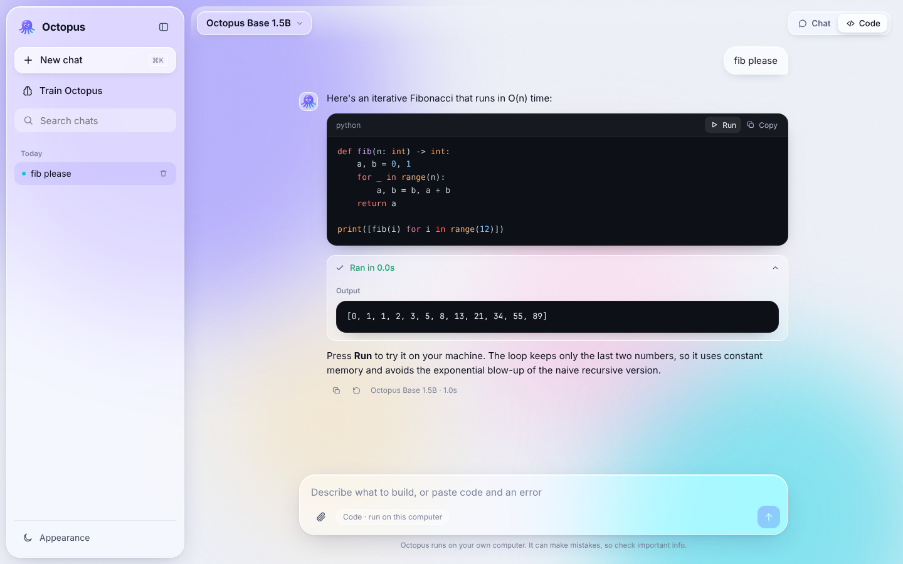
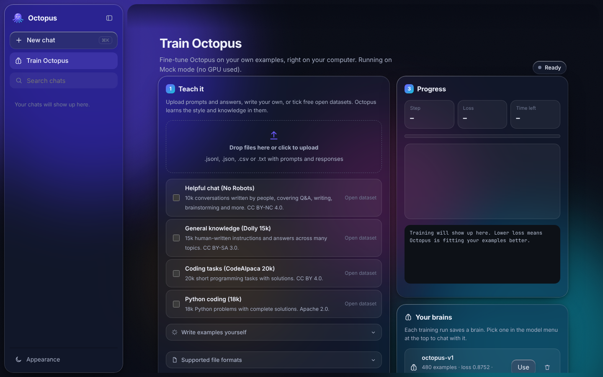

# 🐙 Octopus

Your own AI assistant that runs on **your** computer's GPU. No API, no subscription, no data leaving your machine.

Octopus starts from a free open-source language model (Qwen 2.5 Coder, Apache-2.0) and you make it yours in the **Train** section by fine-tuning it on your own examples. It has a laptop-first, Liquid Glass style web interface with a chat sidebar, a Chat mode and a Coding mode.


## What it does

- **Chat** like any assistant, with streaming replies, Markdown, tables and code highlighting.
- **Coding mode** tuned for programming. Every code block has Copy, and (if you turn it on) a **Run** button that runs Python, JavaScript or Bash on your computer and shows the output, plus an "Ask Octopus to fix it" button when it errors.
- **Train section**: upload prompts and answers, type your own examples, or tick free open datasets. Octopus fine-tunes itself on your GPU with LoRA, shows a live loss chart, and saves the result as a **brain** you can pick from the model menu.
- **Chats are saved** in your browser, searchable, grouped by day.
- Light and dark mode, and works on iPhone too (add it to your home screen).

| Coding mode | Train section |
|---|---|
|  |  |

## Quick start

You need **Python 3.10 to 3.12** ([python.org](https://www.python.org/downloads/), tick "Add Python to PATH" on Windows) and about 10 GB of free disk.

**Windows:** download this repo (green **Code** button, then **Download ZIP**), unzip it, and double-click **`start.bat`**.

**Mac / Linux:**

```bash
git clone https://github.com/physicstheory/octopus.git
cd octopus
./start.sh
```

The first run installs PyTorch and the other libraries (a few GB, several minutes). Your browser then opens **http://localhost:8000**. The first message downloads the model (about 3 GB for the default), after that it starts in seconds.

### Which model fits my GPU?

Pick it from the menu at the top of the chat.

| Model | VRAM | Notes |
|---|---|---|
| Octopus Mini 0.5B | 2 GB | Very fast, simplest answers |
| **Octopus Base 1.5B** | 4 GB | Default, good balance |
| Octopus Plus 3B | 8 GB | Noticeably smarter |
| Octopus Pro 7B | 16 GB (8 GB with 4-bit) | Best coder here |

NVIDIA cards use CUDA, Apple Silicon Macs use Metal. Without a GPU it still works on the CPU, just slowly.

## Training your Octopus

1. Open **Train Octopus** in the sidebar.
2. **Teach it**: drop in files, write examples ("When someone says… Octopus should answer…"), and/or tick open datasets such as *Helpful chat* or *Python coding*.
3. Name the brain, pick a base model and **Quick / Balanced / Thorough**, then **Start training**.
4. Watch the loss fall. When it's done you'll see its answer to your test prompt; press **Chat with it**.

Chat pauses while training, because training needs all of the GPU.

**File formats**

```jsonl
{"prompt": "Who made you?", "response": "Duncan built me. I'm Octopus."}
{"messages": [{"role": "user", "content": "Hi"}, {"role": "assistant", "content": "Hey! What can I do for you?"}]}
```

CSV with `prompt,response` columns (also `instruction,output` or `question,answer`), or plain text:

```text
User: What's the capital of France?
Assistant: Paris.
---
User: Write a haiku about octopuses
Assistant: Eight arms in the deep…
```

**Tips:** a few hundred good examples beat thousands of messy ones. Mix your own examples with an open dataset so Octopus keeps its general skills. If answers get weird or repetitive, train with *Quick* or a lower learning rate.

**About other chatbots' answers:** the terms of ChatGPT, Claude, Gemini and most other commercial assistants forbid using their outputs to train another AI model, so don't build datasets by copying their replies. Your own writing and openly licensed datasets are fine.

## Settings

Set these as environment variables before starting (for example `set OCTOPUS_ALLOW_RUN=1` on Windows, `export OCTOPUS_ALLOW_RUN=1` on Mac/Linux).

| Variable | Default | What it does |
|---|---|---|
| `OCTOPUS_ALLOW_RUN` | `0` | `1` turns on the **Run** button in Coding mode. Code runs on your computer with your user's permissions in a scratch folder, with a 30 second limit, and only for requests from this computer. Read code before you run it. |
| `OCTOPUS_PORT` | `8000` | Port for the web UI |
| `OCTOPUS_BASE_MODEL` | `Qwen/Qwen2.5-Coder-1.5B-Instruct` | Default base model |
| `OCTOPUS_4BIT` | `0` | `1` loads models in 4-bit on NVIDIA (needs `pip install bitsandbytes`), so 7B fits in 8 GB |
| `OCTOPUS_HOST` | `127.0.0.1` | Set to `0.0.0.0` to use Octopus from your phone on the same Wi-Fi (requires `OCTOPUS_PASSWORD`) |
| `OCTOPUS_PASSWORD` | none | Password for the sign-in screen |
| `OCTOPUS_HOME` | `./workspace` | Where datasets and brains are stored |

## Using it from your phone or anywhere

On the same Wi-Fi: start with `OCTOPUS_HOST=0.0.0.0` and a `OCTOPUS_PASSWORD`, then open `http://<your-computer's-IP>:8000` on your phone. In Safari, Share then **Add to Home Screen** makes it feel like an app.

From anywhere: run a tunnel such as `cloudflared tunnel --url http://localhost:8000` and open the HTTPS address it prints. Always set a password first.

## How it works

```
web/            Liquid Glass UI (plain HTML, CSS and JS, no build step)
octopus/
  server.py     FastAPI server: chat streaming, datasets, training and run APIs
  engine.py     Loads the base model plus your LoRA brain and streams tokens
  trainer.py    LoRA fine-tuning loop with live progress events
  data.py       Reads JSONL/JSON/CSV/TXT and the built-in open datasets
  runner.py     Runs code snippets for Coding mode (opt-in)
workspace/      Your datasets and trained brains (not committed to git)
```

Run `OCTOPUS_MOCK=1 python -m octopus` to try the interface without downloading a model.

## License

MIT for this code. Base models are Qwen 2.5 Coder (Apache-2.0); each built-in dataset shows its own license in the Train section.
